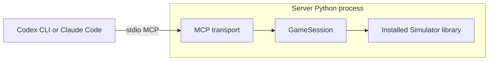

# TFTSimulatorMCP

[TFTSimulatorMCP](https://github.com/KyleDerZweite/TFTSimulatorMCP) provides local stdio MCP tools for the unchanged [original TFT simulator, silverlight6/TFTMuZeroAgent](https://github.com/silverlight6/TFTMuZeroAgent). This repository owns the MCP adapter, tools and tests. The simulator owns game mechanics and remains an external dependency pinned to Git revision `33c2c6eb873da1aaf319dc0c36bcbec1ad20c48d`.

The server controls `player_0` in one seeded eight-player game. Seven opponents use the simulator's existing `Default_Agent(False)` policy. Codex CLI or Claude Code owns model inference and chooses individual MCP actions. The installed Simulator runs in the same Python process as GameSession.



## Get started

```sh
git clone https://github.com/KyleDerZweite/TFTSimulatorMCP.git
cd TFTSimulatorMCP
```

Copy the text block from [SETUP_PROMPT.md](SETUP_PROMPT.md) into Codex CLI or Claude Code with this checkout available. It installs a selected revision in a fresh external environment and connects the named `tft` server. For manual installation, native configuration, connection checks, troubleshooting and removal, follow [docs/setup.md](docs/setup.md).

After setup, copy [GAME_PROMPT.md](GAME_PROMPT.md) into a fresh native session to play one complete game. The host chooses individual actions; information calls are free, and each planning round allows 14 actions before explicit `end_turn`.

## Documentation

- [Tool reference](docs/tool-reference.md): all 25 tools, argument examples, coordinates, error behavior and native simulator limitations.
- [Setup guide](docs/setup.md): installation and native host operations.
- [SPEC.md](SPEC.md): accepted behavior, component responsibilities and acceptance requirements.
- [GLOSSARY.md](GLOSSARY.md): gameplay terms.
- [Verification record](docs/verification.md): tested revisions, historical results and unavailable evidence.
- [Developer checks](docs/tool-reference.md#developer-checks): source checks and separate installed acceptance.

## Limits

The server runs one local game per process. Restarting begins idle; games do not resume. Opponent scouting exposes only public boards, traits and status. Automated carousel decisions and unsupported native operations remain simulator limits. The reference documents equipment and merge cases that reject safely.

This project provides simulator tools. It does not train or host a MuZero model. Codex CLI or Claude Code supplies model inference. PoroSight integration remains future work outside the accepted contract.
