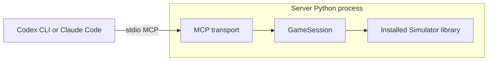

# TFTMuZeroMCP

[TFTMuZeroMCP](https://github.com/KyleDerZweite/TFTMuZeroMCP) provides local stdio MCP tools for the unchanged [original TFT simulator, silverlight6/TFTMuZeroAgent](https://github.com/silverlight6/TFTMuZeroAgent). This repository owns the MCP adapter, tools and tests. The simulator owns game mechanics and remains an external dependency pinned to Git revision `33c2c6eb873da1aaf319dc0c36bcbec1ad20c48d`.

The server controls `player_0` in one seeded eight-player game. Seven opponents use the simulator's existing `Default_Agent(False)` policy. Codex CLI or Claude Code owns model inference and chooses individual MCP actions. The installed Simulator runs in the same Python process as GameSession.



Use [SETUP_PROMPT.md](SETUP_PROMPT.md) to install and connect the server, then [GAME_PROMPT.md](GAME_PROMPT.md) to play. The [tool reference](docs/tool-reference.md) describes all 25 tools and native limitations. [SPEC.md](SPEC.md) owns behavior and architecture; [verification.md](docs/verification.md) records tested revisions and remaining limits. PoroSight integration remains optional future work outside this project contract.

## Install a pinned revision

Use Python 3.10 or newer and a fresh external environment. The old `tft-mcp-server` distribution shares the `tft_mcp` import and `tft-mcp` launcher, so do not mix both packages in an existing environment. No simulator checkout, GPU or model-hosting dependencies are required. Pip installs the unchanged simulator automatically from its pinned Git dependency; Git must be available. This installation makes no promise about a PyPI simulator release.

Clone this repository and replace the paths and full verified MCP revision below. Archive the MCP source and install noneditably so checkout changes cannot change the installed server.

```sh
TFT_REPO=/absolute/path/TFTMuZeroMCP
TFT_INSTALL=/absolute/path/operator-owned/tftmuzero-mcp
TFT_MCP_REVISION=FULL_VERIFIED_MCP_GIT_REVISION
TFT_SIMULATOR_REVISION=33c2c6eb873da1aaf319dc0c36bcbec1ad20c48d
mkdir -p "$TFT_INSTALL/source" "$TFT_INSTALL/host" "$TFT_INSTALL/logs/sdk" "$TFT_INSTALL/logs/codex" "$TFT_INSTALL/logs/claude"
chmod 700 "$TFT_INSTALL" "$TFT_INSTALL/logs"
git init -q "$TFT_INSTALL/host"
git -C "$TFT_REPO" archive --output="$TFT_INSTALL/source.tar" "$TFT_MCP_REVISION"
tar -xf "$TFT_INSTALL/source.tar" -C "$TFT_INSTALL/source"
env -u APPIMAGE python3 -m venv "$TFT_INSTALL/venv"
env -u APPIMAGE "$TFT_INSTALL/venv/bin/python" -m pip install "$TFT_INSTALL/source[dev]"
env -u APPIMAGE "$TFT_INSTALL/venv/bin/python" -m pip check
sha256sum "$TFT_INSTALL/source.tar"
cd "$TFT_INSTALL/host"
env -u APPIMAGE -u PYTHONPATH "$TFT_INSTALL/venv/bin/python" -c 'import sys, Simulator, tft_mcp; from importlib.metadata import version; print(sys.executable, Simulator.__file__, tft_mcp.__file__); print({n:version(n) for n in ("tft-simulator","tftmuzero-mcp","numpy","PettingZoo","gymnasium","mcp")})'
TFT_CHECK_DIR="$(mktemp -d "$TFT_INSTALL/logs/sdk/check-XXXXXX")"
env -u APPIMAGE -u PYTHONPATH TFT_MCP_TEST_COMMAND="$TFT_INSTALL/venv/bin/tft-mcp" "$TFT_INSTALL/venv/bin/python" -m pytest -c "$TFT_INSTALL/source/pyproject.toml" "$TFT_INSTALL/source/tests/test_protocol.py" -k production_discovery_and_idle -q --basetemp="$TFT_CHECK_DIR/protocol"
```

Imports must resolve inside the new venv. The idle SDK check launches the installed server outside both checkouts and verifies exactly 25 tools without starting a game. For installation acceptance that includes test games, use `-k 'not full_lobby and not invalid_output'` instead. The `invalid_output` fixture uses checkout source and belongs to developer checks.

Use a new `TFT_CHECK_DIR` for every run because pytest clears its basetemp directory. Record the MCP revision/archive checksum and simulator commit/source digest separately. Installed simulator `direct_url.json` commit metadata overrides conflicting environment hints. Archive installs may retain an explicit `TFT_MCP_SIMULATOR_REVISION` hint; every install records the actual source SHA-256. Package versions alone do not identify source content.

## Connect a native host

Inspect `codex mcp get tft --json` or `claude mcp get tft` first. Reuse an already correct entry. For an existing entry, update only its launcher, arguments, three TFT environment fields and the Codex server approval default described below. Preserve unrelated settings, environment fields, authentication and per-tool restrictions. Keep configuration file permissions and ownership. Removing and recreating an entry can discard custom policy.

These commands register an absent entry. Run only the command for your host:

```sh
cd "$TFT_INSTALL/host"
codex mcp add tft --env "TFT_MCP_AUDIT_PATH=$TFT_INSTALL/logs/codex/audit.jsonl" --env "TFT_MCP_NATIVE_LOG_DIR=$TFT_INSTALL/logs/codex/native" --env "TFT_MCP_SIMULATOR_REVISION=$TFT_SIMULATOR_REVISION" -- /usr/bin/env -u APPIMAGE "$TFT_INSTALL/venv/bin/tft-mcp"
claude mcp add --scope local --transport stdio tft -e "TFT_MCP_AUDIT_PATH=$TFT_INSTALL/logs/claude/audit.jsonl" -e "TFT_MCP_NATIVE_LOG_DIR=$TFT_INSTALL/logs/claude/native" -e "TFT_MCP_SIMULATOR_REVISION=$TFT_SIMULATOR_REVISION" -- /usr/bin/env -u APPIMAGE "$TFT_INSTALL/venv/bin/tft-mcp"
```

Codex stores registration in `~/.codex/config.toml`. Claude's private local entry belongs to the project in `~/.claude.json`. Use the same external `host` directory for registration and fresh Claude sessions. Its empty Git repository establishes a stable project root without adding client configuration to the source repository.

For this known local server, add the following field to the existing `[mcp_servers.tft]` parent table before any `.env` or per-tool child table:

```toml
default_tools_approval_mode = "approve"
```

This setting trusts current and future tools from the installed `tft` server. Existing per-tool approval and enabled/disabled overrides retain precedence. Preserve global `approval_policy`, sandbox settings and all other server entries. Claude permissions remain unchanged. The server still checks inputs, lifecycle, legality and budget.

The `/usr/bin/env -u APPIMAGE` wrapper avoids interpreter interference on affected AppImage hosts. The launcher fixes `PYTHONHASHSEED=0` before imports. Audit logging is required; native logs default beside the audit file when omitted. Keep SDK and each host's audit, native and session logs separate.

Open a fresh native session and request an actual `tft.get_game_status` call. Registration and discovery alone do not prove tool execution. If the host needs a reload or lacks model access, report that result before claiming connection. CLI examples were checked with Codex 0.162.1 and Claude Code 2.1.294 on 2026-10-10. See [Codex MCP](https://developers.openai.com/codex/mcp/) and [Claude MCP](https://code.claude.com/docs/en/mcp) for host configuration.

## Play and verify

Supply the text block from [GAME_PROMPT.md](GAME_PROMPT.md) to a fresh native session. Reads do not consume budget or randomness. Individual actions consume one of 14 planning slots and interleave baseline decisions. Explicit `end_turn` starts combat and finishes the remaining lobby after controlled elimination. Terminal own categories retain the controlled snapshot; `get_round` reports the final lobby round and `get_players` reports all eight placements.

Board coordinates are x=0..6 left to right and y=0..3 bottom to top. Bench slots are 0..8, shop slots 0..4 and loose inventory slots 0..9. Rules come from installed simulator definitions. See the [server reference](docs/tool-reference.md) for opponent privacy, action schemas and unsupported native cases.

[Developer checks](docs/tool-reference.md#developer-checks) select checkout source explicitly. Installed-launcher checks remain separate. Process restart begins idle; games do not resume. Closing a game preserves its logs.

## Remove the entry

When retiring the setup, remove only the named entry. Claude removal must use its registration directory:

```sh
codex mcp remove tft
cd "$TFT_INSTALL/host"
claude mcp remove --scope local tft
```

Once no host uses the installation, remove its dedicated environment/source directory if wanted. Retain or delete gameplay logs separately.
